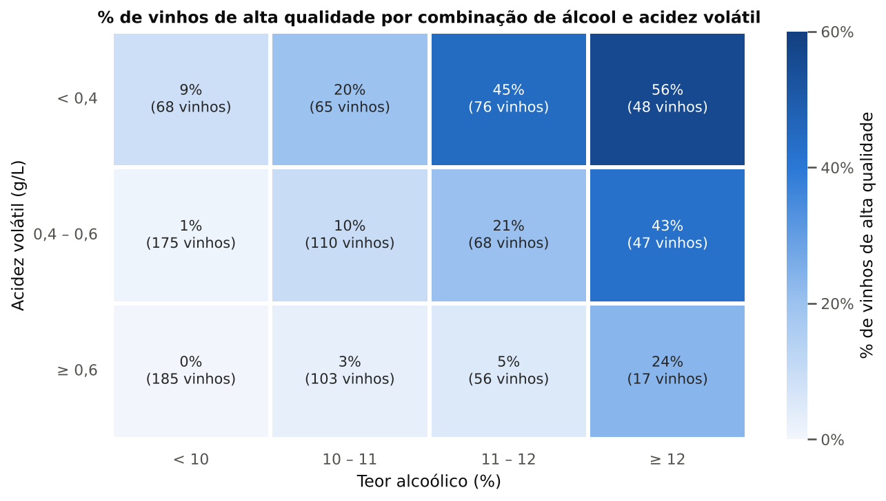
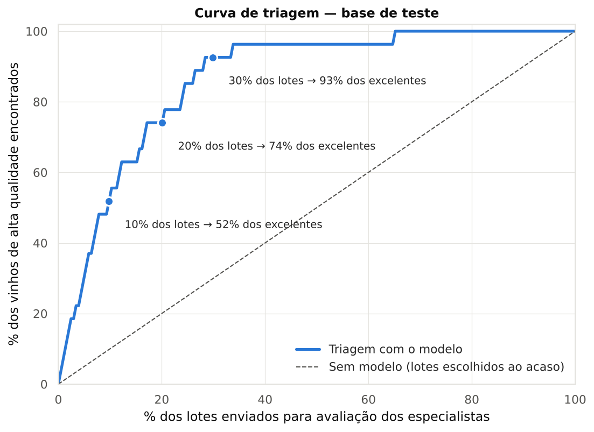

# 🍷 Classificando a qualidade de vinhos com Machine Learning

**Tech Challenge — Fase 2 | POSTECH Data Analytics (FIAP)**

**Integrantes:** Evanio Alves Carvalho · Michael Alves Pateis dos Santos · Guilherme Castilho Feitosa · Natália de Santana Cavalcanti

Este projeto prevê se um vinho tinto será avaliado como de **alta qualidade** (nota ≥ 7) a partir de suas **características físico-químicas**. Além de prever, ele traduz os resultados em **decisões de negócio** para enólogos e produtores: quais lotes priorizar, que metas de processo seguir e quanto se ganha com isso.

---

## 📋 Resumo executivo

| # | Achado | Evidência |
|---|---|---|
| 1 | **Vinhos excelentes são raros**: 1 em cada 7 | 137 de 1.018 vinhos (13,5%) após remover 125 registros duplicados |
| 2 | **Três medidas explicam a diferença**: teor alcoólico (↑), acidez volátil (↓) e sulfatos (↑, até uma faixa ideal) | Maiores tamanhos de efeito (0,50 a 0,65), significativas com correção de Bonferroni (p < 0,001) e as mais importantes no modelo |
| 3 | **Os sinais se somam** | Álcool ≥ 12% e acidez volátil < 0,4 g/L: 56% de excelentes. Álcool < 10% e acidez volátil ≥ 0,6 g/L: nenhum dos 185 |
| 4 | **O modelo escolhido encontra quase 4 em cada 5 vinhos excelentes** | Random Forest (escolhido pela validação cruzada): recall de 78% (21 de 27; IC 95%: 59% a 89%), F1 de 0,59 e ROC AUC de 0,92 em vinhos nunca vistos |
| 5 | **Triagem: avaliar 30% dos lotes encontra 93% dos excelentes** | Curva de triagem na base de teste (IC 95%: 77% a 98%; ao acaso, seriam ~30%) |
| 6 | **As faixas de chance acompanham a realidade** | Faixa "Prioridade" (≥ 40%): 65% eram excelentes. Faixa "Baixo potencial" (< 10%, 70% dos lotes): só 1,4% |
| 7 | **O perfil completo multiplica a chance** | Simulador: vinho típico com ~2%; as duas metas de processo (álcool e acidez volátil) juntas triplicam (~6%); o perfil completo dos excelentes, com sulfatos na faixa de referência, chega a ~24% |
| 8 | **Impacto operacional** | A cada 1.000 lotes, ~700 de baixo potencial podem ir para avaliação simplificada: **~70% menos avaliações completas**, mantendo ~93% dos excelentes no fluxo prioritário. A triagem compensa enquanto um premium perdido valer menos que **~72 vezes** a economia por avaliação (estimativa baseada em poucos casos: faixa provável de ~20 a ~260 vezes) |

**Recomendações:** priorizar a avaliação sensorial com a ferramenta; definir metas de processo para álcool (≥ 11,5%) e acidez volátil (< 0,4 g/L); tratar os sulfatos (0,65 a 0,85 g/L nos melhores vinhos) como **sinal a investigar**, sem elevar o SO₂ total; e validar tudo em um **piloto na próxima safra**.

## 🎤 Apresentação executiva

O storytelling da análise, em linguagem de negócio:
- [`presentation/apresentacao_executiva.pdf`](presentation/apresentacao_executiva.pdf) (visualização direta no GitHub)
- [`presentation/apresentacao_executiva.pptx`](presentation/apresentacao_executiva.pptx) (13 slides, editável, com anotações do apresentador)

## 📌 O problema

A avaliação da qualidade de um vinho é feita por especialistas, em análises sensoriais subjetivas, demoradas e realizadas no fim da produção. Durante a produção, porém, já são coletadas medidas de laboratório. **Essas medidas conseguem antecipar a avaliação dos especialistas?**

- **Base:** [Wine Quality Dataset (WineQT)](https://www.kaggle.com/datasets/yasserh/wine-quality-dataset), Kaggle: 1.143 amostras de Vinho Verde tinto (Portugal), 11 variáveis físico-químicas e a nota de qualidade. Cada amostra é tratada como um lote de produção.
- **Variável alvo:** `alta_qualidade` = 1 se `quality ≥ 7`, senão 0.
- **Por que nota ≥ 7?** Com corte em 6, mais da metade dos vinhos (54%) seria "alta qualidade", incluindo os medianos. Com corte em 8, sobrariam só 15 vinhos (1,5%), poucos demais para treinar. O corte em 7 isola os **13,5% realmente acima do padrão**, que são os de valor premium, e ainda deixa exemplos suficientes (137) para o modelo aprender.
- **Tipo de problema:** classificação binária supervisionada, com **classes desbalanceadas** (~13,5% de vinhos de alta qualidade).

### Dicionário de variáveis

| Variável | Português | O que mede | Unidade |
|---|---|---|---|
| `fixed acidity` | Acidez fixa | Ácidos não voláteis (tartárico, málico) | g/L |
| `volatile acidity` | Acidez volátil | Principalmente ácido acético (em excesso, aroma de vinagre) | g/L |
| `citric acid` | Ácido cítrico | Frescor e equilíbrio | g/L |
| `residual sugar` | Açúcar residual | Açúcar que sobra após a fermentação | g/L |
| `chlorides` | Cloretos | Teor de sal | g/L |
| `free sulfur dioxide` | SO₂ livre | Parte ativa do conservante | mg/L |
| `total sulfur dioxide` | SO₂ total | SO₂ livre + combinado | mg/L |
| `density` | Densidade | Massa por volume (depende de álcool e açúcar) | g/cm³ |
| `pH` | pH | Grau de acidez | — |
| `sulphates` | Sulfatos | Sulfato de potássio (associado ao manejo do SO₂) | g/L |
| `alcohol` | Teor alcoólico | Percentual de álcool | % vol. |
| `quality` | Qualidade | Nota sensorial dos especialistas (**variável alvo**) | 0 a 10 |

## 🗂️ Estrutura do repositório

```
wine-quality-classification/
│
├── data/                     # Base de dados utilizada (WineQT.csv)
├── notebooks/                # Notebook com toda a análise e modelagem
│   └── wine_quality_classification.ipynb
├── src/                      # Scripts auxiliares
│   ├── config.py             # Caminhos, sementes e constantes
│   ├── data_preprocessing.py # Carga, limpeza, alvo, feature engineering, split
│   ├── eda.py                # Gráficos e testes estatísticos da EDA
│   ├── modeling.py           # Pipelines, GridSearchCV e calibração
│   ├── evaluation.py         # Métricas, overfitting, ROC, triagem, importância
│   ├── simulation.py         # Simulador "e se?", faixas de ação, lotes de exemplo e cenário em R$
│   └── train.py              # Executa a modelagem pelo terminal
├── results/                  # Gráficos (figures/) e tabelas (.csv) dos resultados
├── presentation/             # Apresentação executiva (PPTX e PDF)
├── requirements.txt          # Bibliotecas utilizadas
└── README.md                 # Descrição do projeto
```

## ▶️ Como executar

```bash
# 1. Instalar as dependências
pip install -r requirements.txt

# 2. Abrir o notebook (análise completa, passo a passo; execução de ~3 a 6 minutos)
#    Dica: o índice no topo tem um roteiro de leitura rápida (~5 min)
jupyter notebook notebooks/wine_quality_classification.ipynb

# ou executar apenas a modelagem pelo terminal
python -m src.train
```

> No **Google Colab**, faça o upload da pasta do projeto (ou clone o repositório) e execute o notebook a partir da pasta `notebooks/`.

## 🔎 Etapas do projeto

| Etapa | O que foi feito |
|---|---|
| **1. Compreensão do problema** | Contexto de negócio, decisões apoiadas, **dicionário de variáveis**, definição do alvo e **justificativa do corte** (≥ 7 = alta) |
| **2. EDA** | Estatística descritiva, histogramas e boxplots por classe, outliers (IQR), **Shapiro-Wilk** e **Mann-Whitney** (com **correção de Bonferroni** e **tamanho do efeito**), correlações de **Pearson** e **Spearman** com **justificativa de cada variável e de cada par relevante**, **análise combinada** (álcool × acidez volátil), balanceamento |
| **3. Pré-processamento** | Sem dados faltantes; remoção de **125 duplicados**; outliers mantidos (plausíveis); split 80/20 **estratificado**; **StandardScaler** dentro de `Pipeline`; feature engineering testada em validação cruzada |
| **4. Modelos** | **Regressão Logística**, **KNN**, **SVM**, **Árvore de Decisão** e **Random Forest**, com `class_weight='balanced'` e `GridSearchCV` (StratifiedKFold de 5 folds, otimizando F1). Comparação com **oversampling (SMOTE)**, que não trouxe ganho |
| **5. Avaliação** | Validação cruzada, acurácia, precisão, recall, **F1**, **ROC AUC**, matrizes de confusão, **checagem de overfitting**, classification report e trade-off do limiar |
| **6. Interpretação e previsões** | Importância por permutação; **probabilidades calibradas**; **curva de triagem**; **simulador "e se?"**; **faixas de ação** com lotes de exemplo; **intervalos de confiança**; **impacto operacional** por 1.000 lotes; **cenário em R$** com regra de equilíbrio e sensibilidade; implicações para a produção |
| **7. Conclusão** | Resposta à pergunta de negócio e recomendação de piloto |
| **8. Reprodutibilidade** | Célula que recalcula os números citados no texto e confere se batem (✅) |

## 📊 Principais resultados

### Desempenho na base de teste (204 vinhos, 27 de alta qualidade)

| Modelo | Acurácia | Precisão | Recall | F1 | ROC AUC |
|---|---|---|---|---|---|
| Regressão Logística | 0,789 | 0,362 | 0,778 | 0,494 | 0,881 |
| KNN | **0,897** | **0,650** | 0,481 | 0,553 | 0,874 |
| SVM | 0,814 | 0,388 | 0,704 | 0,500 | 0,889 |
| Árvore de Decisão | 0,828 | 0,420 | 0,778 | 0,545 | 0,832 |
| **Random Forest** | 0,858 | 0,477 | **0,778** | **0,592** | **0,921** |

**Modelo escolhido: Random Forest**, pelo maior F1 na **validação cruzada** (0,538 ± 0,077; AUC 0,875 ± 0,037). A base de teste confirma a escolha: também é o melhor F1 e ROC AUC em vinhos nunca vistos, com menos alarmes falsos que os modelos de mesmo recall.

> ⚠️ O KNN tem a maior acurácia, mas encontra **menos da metade** dos vinhos bons e tem F1 = 1,00 no treino (decora os dados). Em bases desbalanceadas, **acurácia alta não significa modelo bom**.

<p align="center">
  
  
</p>

### O que mais influencia a qualidade

| Fator | Vinhos de alta qualidade | Demais vinhos | Efeito |
|---|---|---|---|
| 🥇 **Teor alcoólico** | 11,7% | 10,0% | ⬆️ positivo |
| 🥈 **Sulfatos** | 0,74 g/L | 0,60 g/L | ⬆️ positivo, até ~0,85 g/L (marcador, não meta) |
| 🥉 **Acidez volátil** | 0,36 g/L | 0,55 g/L | ⬇️ negativo |

*(medianas; diferenças significativas pelo teste de Mann-Whitney, p < 0,001)*

### Uso no negócio: faixas de ação (base de teste)

| Faixa de chance prevista | Lotes | Taxa real de excelência | Ação |
|---|---|---|---|
| **Prioridade** (≥ 40%) | 23 (11%) | **65%** | Avaliar primeiro; candidato à linha premium |
| **Avaliar** (10% a 40%) | 38 (19%) | **26%** | Avaliar em seguida; revisar medidas-chave |
| **Baixo potencial** (< 10%) | 143 (70%) | **1,4%** | Não priorizar; investigar o processo |

## ⚠️ Limitações
- Base pequena e desbalanceada (apenas 27 vinhos bons no teste): os resultados têm intervalos de confiança largos e devem ser lidos como ordem de grandeza.
- Apenas Vinho Verde tinto, sem variáveis de uva, safra, região ou processo. As medidas são do vinho pronto: em produção, o modelo precisaria ser validado com medidas de etapas intermediárias.
- O modelo e o simulador mostram **associações**, não causalidade: mudanças no processo devem ser testadas em lotes-piloto.

## 🛠️ Tecnologias
Python · pandas · NumPy · SciPy · scikit-learn · Matplotlib · seaborn · Jupyter
